# PO-158 · D-265 · La città dalla foto del telefono del PO

Sviluppatrice S-26, ramo `claude/valmora-citta-158`.
- «Prima»: build 0.61.0, cioè main prima di PO-158.
- «Dopo»: build del merge della 0.65.0 + D-274 (`11f33352`, la versione si legge in basso a sinistra).

## Come sono fatte le foto e le misure
- Comando: `node coordination/handoffs/sviluppatrice/d265/misura.mjs <cartella> [dist]`, dal repo. Lo strumento:
  - usa Chromium headless shell 1248, cioè quello della CI (`VALMORA_CHROME`);
  - imposta i caratteri fissi di `tools/caratteri.mjs`;
  - fotografa la città alla prima partita, con l'episodio 1 scelto;
  - poi misura le tre stagioni con tutti gli episodi conclusi.
- Le foto non vengono dal telefono: sul dispositivo Android vero è **Non verificato**.

## Misure, prima → dopo

Larghezze 360/375/412 × altezze 640/760/830/915, 12 finestre.

| Cosa | Prima | Dopo | Guardiano (rosso) |
|---|---|---|---|
| Spazio sopra le teste nella striscia (760/830/915) | 104–131 px | 16 px (il secondo personaggio 35–36) | C265S01 |
| Petto visibile (distanza dal bordo basso) | personaggi tagliati sopra il petto | 9–11 px sotto il petto | C265S01 |
| Distanza minima fra bolle, episodio scelto | −4,9 px (sovrapposte a 640 e 760) | 26,8 px | C265B01 |
| Distanza minima fra bolle, 3 stagioni × 12 finestre | −5,2 px, 6 sovrapposizioni | 26,8 px, 0 sovrapposizioni | C265B01 |
| Bolle bloccate | opacità 0,4 | opacità 1, contrasto 5,85:1 | C265C01 |
| Nomi delle squadre tagliati nella scheda | «Skyfield At…» a 360 e 375 | 0, su due righe | C265N01 |
| Pagina che scorre | 0 | 0 | — |

Nome dell'episodio scelto fuori dal suo disco (C20-03 a 412×915): 3 → 0. Rosso C265D01.

## Foto

| Finestra | Prima | Dopo |
|---|---|---|
| 360×640 | 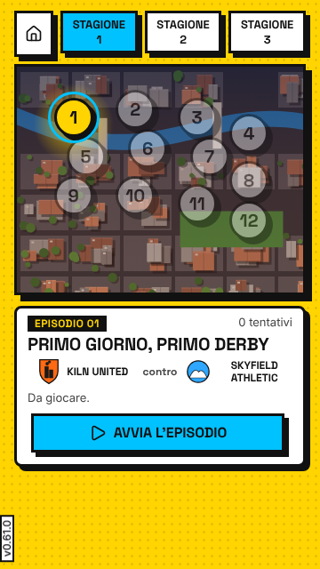 | 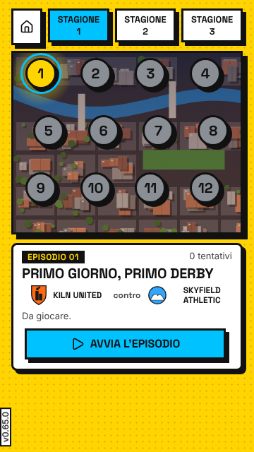 |
| 360×760 | 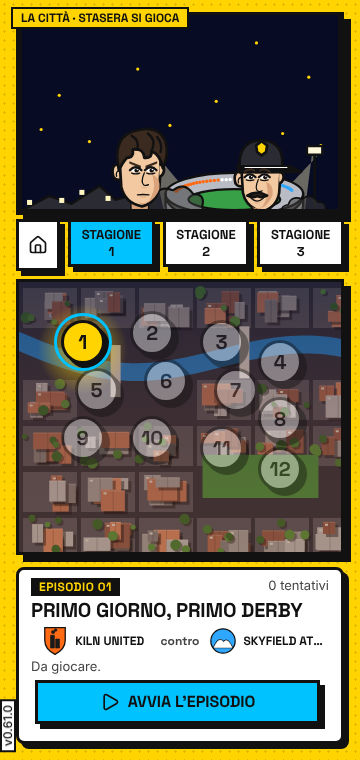 | 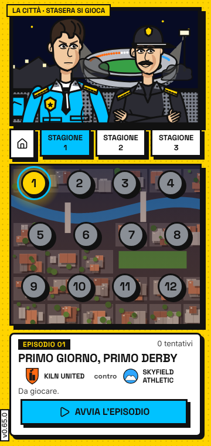 |
| 360×830 | 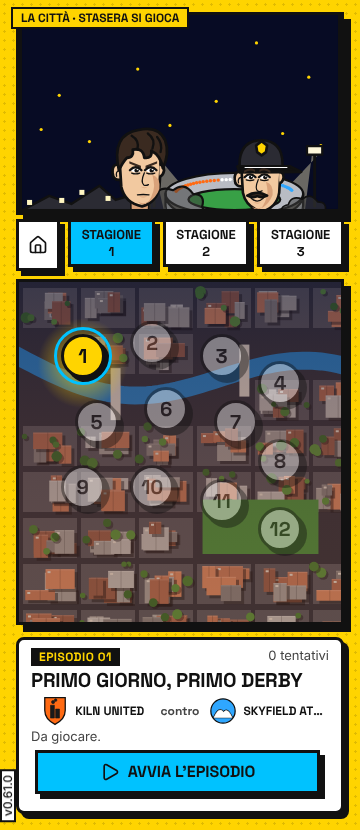 | 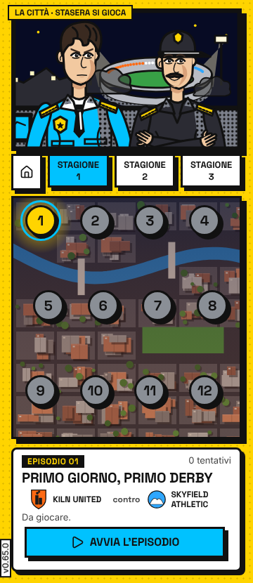 |
| 360×915 |  | 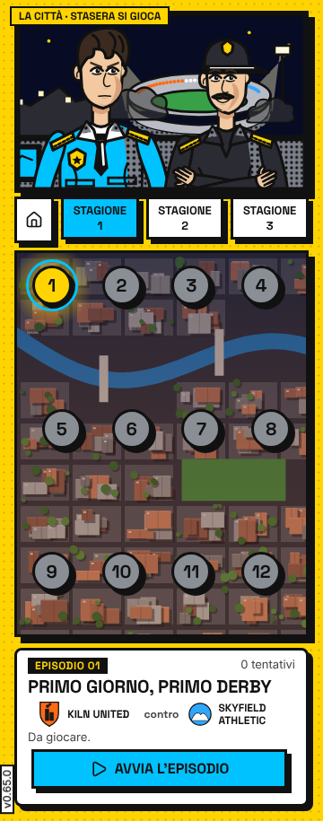 |
| 375×640 | 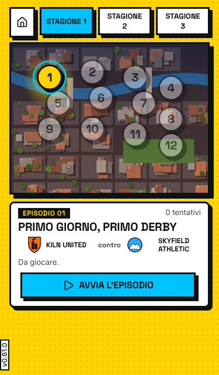 | 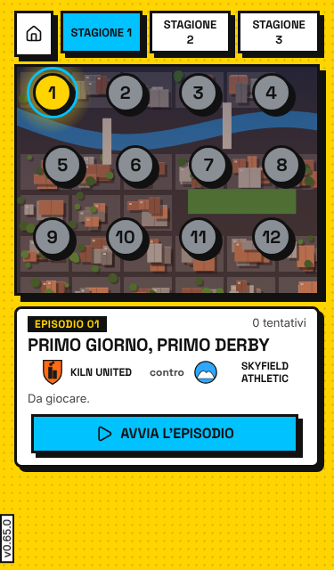 |
| 375×760 |  | 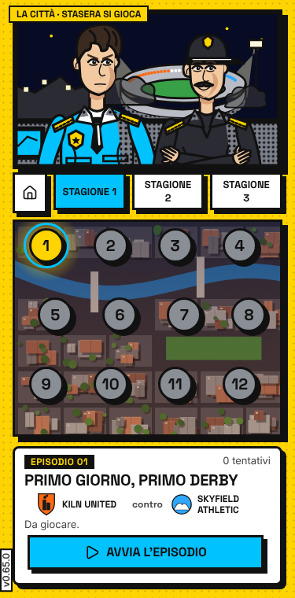 |
| 375×830 | 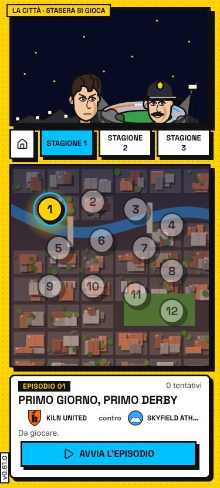 | 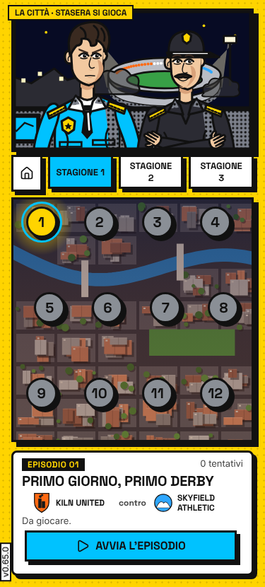 |
| 375×915 | 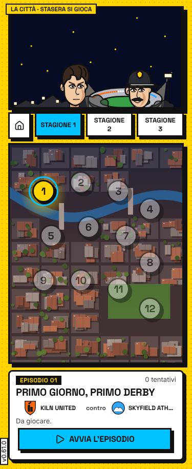 | 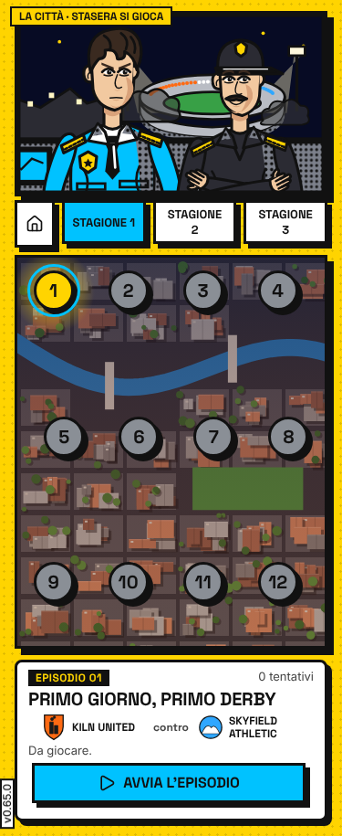 |
| 412×640 | 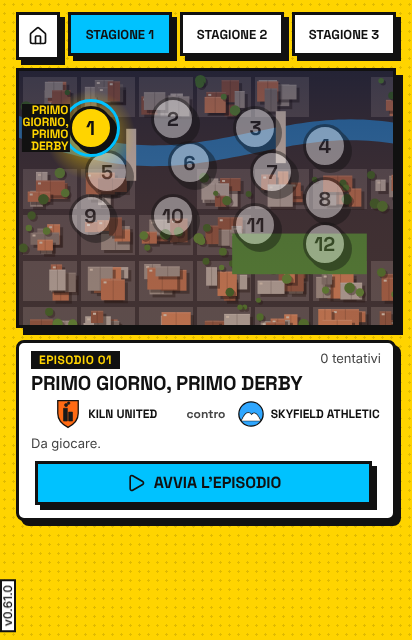 | 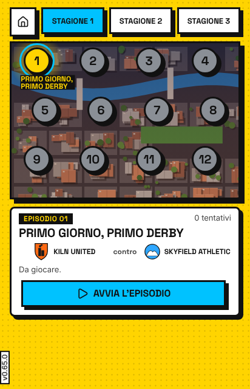 |
| 412×760 | 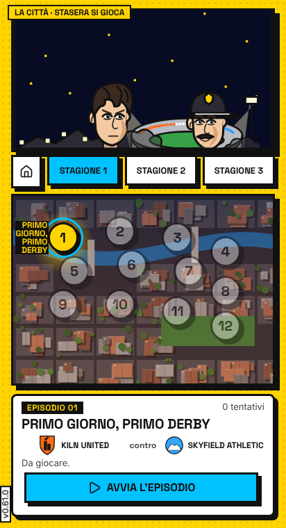 | 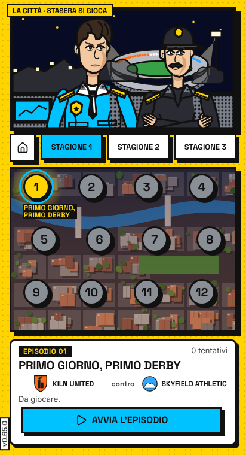 |
| 412×830 | 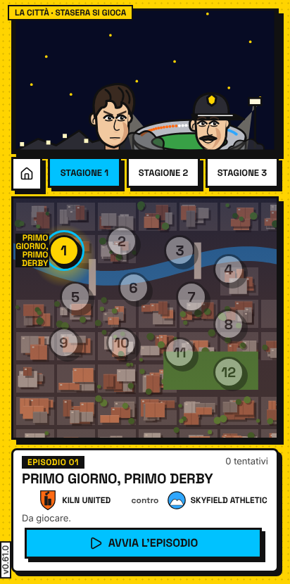 | 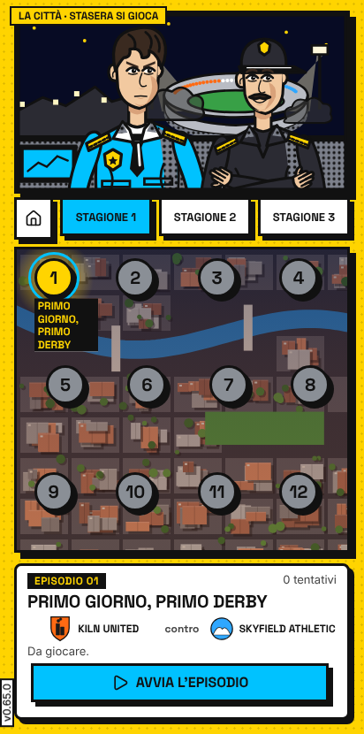 |
| 412×915 | 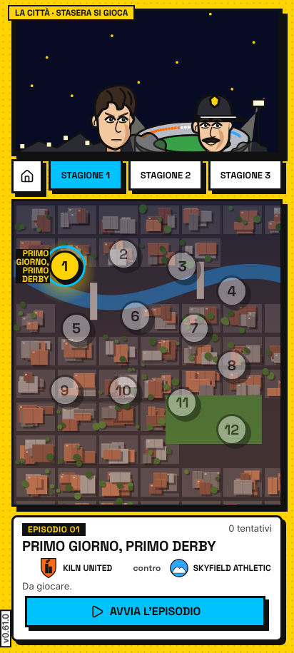 | 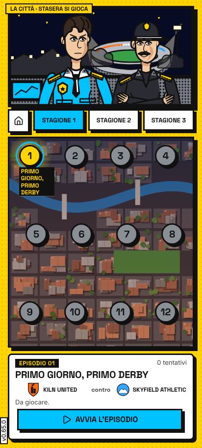 |

## Sul merge della 0.65.0 + D-274 (`11f33352`)

| Controllo | Esito |
|---|---|
| Sonda-altezze, parti della città (citta36, po149, po158, c52nomi), a 360x640, 360x760, 375x667, 375x760, 412x830, 412x760 | 0 errori |
| Sonda-altezze, tutte le 13 parti, sul merge della 0.64.0 (`e8e63953`) | 0 errori |
| Passo «foto» a 360/375/412, città senza WebGL compresa | 0 problemi, 1446 s |
| Misure qui sopra | uguali a quelle su 684e6ece e su e8e63953 (48 stati su 48) |

Le misure dei tempi del passo «altezze» stanno in DECISIONI, D-265-S.
